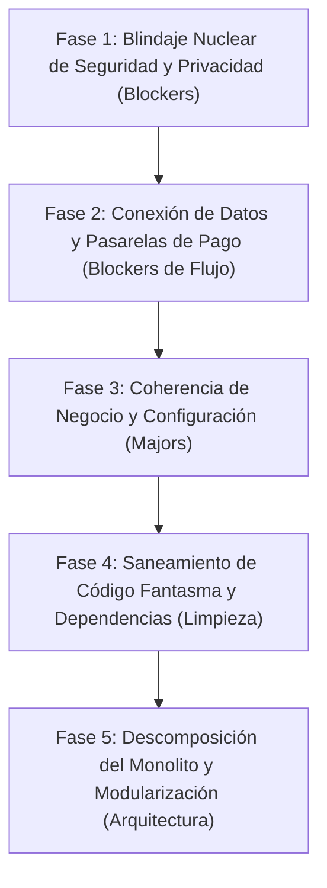

# 🛠️ Plan de Mejoras Priorizadas y Hoja de Ruta EGM (Actualizado)

**Objetivo:** Resolver metódicamente las 8 fallas críticas (Blockers), 7 fallas mayores (Majors) y sanear el código fantasma detectado por la suite EGM.  
**Metodología:** Ejecución por fases de menor a mayor riesgo, con pruebas locales rigurosas y confirmación previa del usuario.  

---

## 📅 Hoja de Ruta de Ejecución por Fases

---

## 1. Fase 1: Blindaje Nuclear de Seguridad y Privacidad (Blockers Críticos)

### Tarea 1.1: Aislar Secretos de `settings` de la Lectura Pública de Supabase
* **Problema:** `resend_api_key`, `vault_dominioschile` y `vault_vercel` son legibles por cualquier usuario anónimo debido a `CREATE POLICY ... ON settings FOR SELECT USING (true)`.
* **Solución Técnica:**
  - Crear una vista o función RPC `get_public_settings()` que solo retorne llaves públicas (`company_name`, `company_email`, `company_phone`, `company_address`, `whatsapp_number`, `default_admin_commission`, `bank_*`).
  - Restringir la tabla `public.settings` con RLS para que solo usuarios autenticados con rol `'admin'` puedan ejecutar `SELECT` sobre toda la tabla.

### Tarea 1.2: Acotar la Lectura de `event_quotes` a la Cotización Específica
* **Problema:** Política `anon USING (true)` permite descargar masivamente cotizaciones con nombres de colegios, teléfonos, correos y RUTs.
* **Solución Técnica:**
  - Crear función RPC `get_public_event_quote(p_quote_id UUID)` con `SECURITY DEFINER` que devuelva solo los campos necesarios para el pago y restringir el RLS directo.

### Tarea 1.3: Restaurar Consulta Legítima en el Portal del Huésped (`/reserva` y `/reserva/[id]`)
* **Problema:** Al bloquearse SELECT en `bookings` para `anon`, los huéspedes legítimos no pueden consultar su reserva en el cliente.
* **Solución Técnica:**
  - Crear la función RPC `get_public_booking_by_id(p_booking_id UUID)` con `SECURITY DEFINER` que devuelva cabaña, fechas, total, abono acumulado y saldo remanente.
  - Actualizar `src/app/reserva/[id]/page.tsx` para consumir esta función RPC.
  - Crear función RPC de búsqueda puntual `search_public_booking(p_query TEXT)` que reciba RUT o código de reserva y devuelva únicamente coincidencias exactas.

### Tarea 1.4: Implementar RPC para Rollback de Reservas Fallidas en Checkout
* **Problema:** `supabase.from('bookings').delete()` falla en el cliente porque `anon` no tiene permisos `DELETE`.
* **Solución Técnica:**
  - Crear función RPC `cancel_provisional_booking(p_booking_id UUID)` que elimine la reserva provisional si la conexión a pasarela falla.

### Tarea 1.5: Corregir Escalación a `admin` en `checkAdmin()` y `isStaffOrAdmin()`
* **Problema:** Usuarios sin perfil en `profiles` son promovidos automáticamente a rol `'admin'`.
* **Solución Técnica:** Asignar rol `'staff'` como fallback de seguridad o rechazar con `403 Forbidden` si no existe perfil configurado explícitamente.

---

## 2. Fase 2: Conexión de Datos y Pasarelas de Pago (Blockers de Flujo)

### Tarea 2.1: Reconciliación Segura en `checkout/success` contra la API de Mercado Pago
* **Problema:** La confirmación de reserva se ejecuta ciegamente al detectar `status=approved` en los parámetros de la URL sin verificar la API de Mercado Pago.
* **Solución Técnica:** Invocar `mpPayment.get({ id: paymentId })` en el servidor y verificar que el cobro esté aprobado y pertenezca a la cuenta de Rancho Carmelitas antes de confirmar la reserva y registrar el pago.

### Tarea 2.2: Blindar Confirmación de Eventos en `/recinto-completo/pago`
* **Problema:** El cliente intenta actualizar `event_quotes` y dispara correos de confirmación sin verificación de pasarela.
* **Solución Técnica:** Eliminar la mutación en el cliente y delegar la confirmación y despacho de correos exclusivamente al Webhook de Mercado Pago.

### Tarea 2.3: Unificar la Galería de la Landing Page (`landing_gallery` vs `landing_moments`)
* **Problema:** El CMS guarda en `landing_gallery` pero la web pública consulta `landing_moments`.
* **Solución Técnica:** Modificar `src/app/page.tsx:136` para consultar `landing_gallery` con orden por `order_index`.

---

## 3. Fase 3: Coherencia de Negocio y Configuración (Majors)

### Tarea 3.1: Depuración de la Amenidad "Pet Friendly"
* **Acción:** Remover `"Pet Friendly"` del array `AVAILABLE_AMENITIES` en `src/app/admin/cabanas/page.tsx:10`.

### Tarea 3.2: Unificación de Dominios y Puertos
* **Acción:**
  - Crear variable de entorno `NEXT_PUBLIC_SITE_URL`.
  - Reemplazar `'http://localhost:3005'` por `process.env.NEXT_PUBLIC_SITE_URL || 'http://localhost:3000'`.
  - Unificar dominios de producción a `https://ranchocarmelitas.com` (o `.cl` según DNS).

### Tarea 3.3: Soporte de Eventos en `/api/mercadopago/sync`
* **Acción:** Agregar bifurcación para `EVENT__` en `src/app/api/mercadopago/sync/route.ts:31`.

### Tarea 3.4: Agregar `notification_url` en `event-preference`
* **Acción:** Configurar `notification_url` hacia `/api/mercadopago/webhook` en `src/app/api/mercadopago/event-preference/route.ts`.

### Tarea 3.5: Proteger `/api/send-event-quote-email`
* **Acción:** Agregar validación `isStaffOrAdmin()` para acciones de aprobación o confirmación forzada.

### Tarea 3.6: Estandarización de Localización Fecha Chilena
* **Acción:** Reemplazar `'es-MX'` por `'es-CL'` en `CheckoutForm.tsx` y `CheckoutSuccessPage`.

---

## 4. Fase 4: Saneamiento de Código Fantasma y Dependencias

### Tarea 4.1: Purgar Archivos Muertos y Carpetas Vacías
* **Acción:**
  - Eliminar `rancho-carmelitas-web/esquema_produccion.sql` (0 bytes).
  - Eliminar `rancho-carmelitas-web/download-logo.js`.
  - Eliminar `rancho-carmelitas-web/verify-rls.js`.
  - Eliminar carpeta `rancho-carmelitas-web/src/components/layout/`.
  - Eliminar script duplicado `rancho-carmelitas-web/src/lib/setup_audit_logs.sql`.
  - Mover los 21 scripts obsoletos de `scratch/` a archivo.

### Tarea 4.2: Mover `@supabase/supabase-js` a `dependencies`
* **Acción:** En `package.json`, transferir `@supabase/supabase-js` de `devDependencies` a `dependencies`.

### Tarea 4.3: Generar Tipos Reales de Supabase
* **Acción:** Generar `src/lib/database.types.ts` con la CLI de Supabase.

---

## 5. Fase 5: Descomposición del Monolito y Modularización

### Tarea 5.1: Modularizar `src/app/admin/reservas/page.tsx`
* **Acción:** Descomponer el archivo de 4.837 líneas en sub-componentes especializados bajo `src/components/admin/reservas/`:
  - `BookingsTable.tsx`
  - `PaymentsTimelineModal.tsx`
  - `CheckInModal.tsx`
  - `CheckOutModal.tsx`
  - `AccountingSiiTab.tsx`
  - `ManualBookingModal.tsx`

### Tarea 5.2: Renombrar `/admin/configuracion` a `/admin/canales`
* **Acción:** Clarificar el enrutamiento y configurar redirect en `next.config.ts`.
