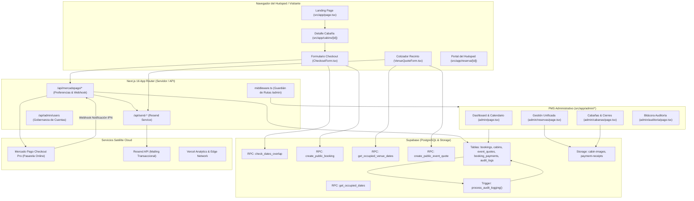

# 🏗️ Documentación Técnica: Arquitectura General del Sistema

**Proyecto:** Rancho Carmelitas Web & PMS  
**Versión Actual del Sistema:** v2.0.0 (Noviembre 2026)  
**Entorno de Ejecución:** Producción (`https://ranchocarmelitas.cl` / `https://ranchocarmelitas.com`) y Local (`Node.js 18+`, Next.js 16)  

---

## 1. Visión General del Sistema

Rancho Carmelitas Web & PMS es una plataforma integral que unifica:
1. **Portal Público para Clientes y Visitantes:** Landing page comercial de alta conversión, catálogo interactivo de cabañas, cotizador y checkout con cálculo de adicionales, portal de reserva con pago online vía Mercado Pago o transferencia bancaria, buscador unificado de reservas, y cotizador/portal de arriendo de recinto completo (eventos diurnos de 8 horas).
2. **PMS (Property Management System) Operativo:** Panel administrativo protegido por autenticación y roles RBAC para la gestión del ciclo de vida de estancias (reservas, abonos múltiples, confirmaciones automáticas al 50%, check-in defensivo con liquidación obligatoria de saldos, check-out físico asistido, housekeeping/limpieza de cabañas, cierres temporales, auditoría en tiempo real y reportabilidad contable para el SII).

---

## 2. Stack Tecnológico Fidedigno

A partir de la auditoría directa del archivo `package.json` y la estructura de archivos del proyecto, la pila tecnológica oficial se compone de:

| Capa | Tecnología | Versión | Función en el Sistema |
| :--- | :--- | :--- | :--- |
| **Core Framework** | [Next.js](https://nextjs.org/) | `16.1.6` (App Router) | Servidor SSR, Server Actions, API Routes y empaquetado frontend con compilador Turbopack. |
| **Librería UI** | [React](https://react.dev/) / React DOM | `19.2.3` | Renderizado reactivo de componentes e interfaces interactivas. |
| **Lenguaje** | [TypeScript](https://www.typescriptlang.org/) | `^5.x` | Tipado estático y contratos de interfaces. |
| **Estilos** | [Tailwind CSS](https://tailwindcss.com/) | `^4.x` con `@tailwindcss/postcss` | Sistema de clases utilitarias de última generación y diseño responsivo adaptativo. |
| **CSS Auxiliar** | Vanilla CSS modular | Nativo | Micro-animaciones Stitch UI, acabados glassmorphism y transiciones fluidas. |
| **Base de Datos** | [Supabase](https://supabase.com/) (PostgreSQL 15+) | Nube / Extensiones `pgcrypto` | Almacenamiento relacional, Triggers PL/pgSQL, Funciones RPC y Row Level Security (RLS). |
| **Autenticación** | Supabase Auth (`@supabase/ssr` `^0.9.0`) | Nube | Gestión de sesiones con cookies HTTP-only, flujo PKCE e invitaciones de usuarios por email. |
| **Pasarela de Pago** | [Mercado Pago SDK](https://www.mercadopago.cl/) (`mercadopago`) | `^3.6.1` | Generación de Checkout Pro (`Preference`), procesamiento de pagos con tarjetas/Webpay y webhook asíncrono (`Payment`). |
| **Mailing** | [Resend](https://resend.com/) (`resend` `^6.9.3`) | Nube | Despacho de correos transaccionales salientes de alta entregabilidad. |
| **Plantillas Mail**| `@react-email/components` / `@react-email/render` | `^1.0.9` / `^2.0.4` | Diseño de correos responsivos maquetados en tablas HTML para compatibilidad total con clientes de correo (Gmail, Outlook). |
| **Métricas** | `@vercel/analytics` | `^1.4.0` | Medición de tráfico y Core Web Vitals, con bypass configurado para sesiones de administradores. |
| **Hosting / Cloud**| [Vercel](https://vercel.com) | Edge / Serverless | Despliegue continuo (CI/CD) conectado al repositorio de GitHub. |

---

## 3. Mapa de Estructura de Directorios

La estructura física del código dentro de `rancho-carmelitas-web/` se organiza de la siguiente manera:

```
rancho-carmelitas-web/
├── .env.local                       # Variables de entorno locales (Supabase, Resend, Mercado Pago)
├── .env.prod                        # Variables de entorno de referencia para producción
├── next.config.ts                   # Configuración del motor Next.js (optimización de imágenes remotas)
├── package.json                     # Declaración de dependencias y scripts de construcción
├── tailwind.config / postcss        # Configuración del pipeline de diseño Tailwind CSS v4
├── tsconfig.json                    # Reglas de compilación y aliases (@/* -> ./src/*)
│
├── public/                          # Recursos estáticos servidos directamente en la raíz
│   ├── og-image.jpg / og-image.png  # Fotografía oficial para previsualización en WhatsApp / RRSS
│   ├── logo.png                     # Isotipo circular del Rancho
│   └── cabins/                      # Recursos visuales y banners institucionales
│
├── migration/                       # Herramientas de migración y clonación de entornos
│   ├── crear_esquema_completo.sql   # DDL consolidado de tablas, funciones y triggers
│   ├── clonar_datos_completos.js    # Script de sincronización Producción -> Test
│   └── importador.js                # Ingesta masiva de planillas Excel históricas
│
├── documentacion/                   # Centro de documentación formal del sistema
│   ├── tecnica/                     # Especificaciones de ingeniería, APIs y BD
│   └── usuario/                     # Manuales funcionales paso a paso para el PMS
│
└── src/
    ├── middleware.ts                # Guardián perimetral de sesiones y rutas /admin
    │
    ├── app/                         # Enrutamiento App Router de Next.js
    │   ├── layout.tsx               # Shell raíz con metadatos globales, Open Graph y JSON-LD
    │   ├── page.tsx                 # Landing Page pública oficial
    │   ├── not-found.tsx            # Pantalla branded 404 personalizada
    │   ├── robots.ts / sitemap.ts   # Generación dinámica de directivas SEO
    │   │
    │   ├── login/                   # Portal de autenticación, recuperación y cambio de clave
    │   ├── cabins/[id]/             # Detalle narrativo de cabaña, fotos y reservas
    │   ├── checkout/[id]/           # Formulario de contratación y desglose financiero
    │   │   └── success/             # Pantalla de confirmación y datos de transferencia
    │   ├── recinto-completo/        # Cotizador oficial de arriendo de recinto (8 horas)
    │   │   └── pago/                # Portal de seguimiento y pago de cotización de eventos
    │   ├── reserva/                 # Búsqueda unificada de reservas y eventos
    │   │   └── [id]/                # Portal del Huésped (detalle de estadía y saldo online)
    │   ├── reglamento/              # Portal oficial de normas y cartelería física
    │   ├── privacidad/              # Políticas legales de protección de datos (Ley N° 19.628)
    │   │
    │   ├── api/                     # Backend Serverless Endpoints
    │   │   ├── admin/users/         # Gestión de colaboradores y reseteo de claves
    │   │   ├── mercadopago/         # Preferencias, sincronización manual y Webhook IPN
    │   │   │   ├── create-preference/
    │   │   │   ├── event-preference/
    │   │   │   ├── sync/
    │   │   │   └── webhook/
    │   │   ├── send-confirmation/   # Correo de solicitud de reserva recibida
    │   │   ├── send-payment-confirmation/ # Correo con desglose de abonos confirmados
    │   │   ├── send-cancelation/    # Correo multicanal de cancelación
    │   │   ├── send-checkout-thankyou/ # Correo de despedida y agradecimiento
    │   │   └── send-event-quote-email/ # Mailing transaccional de cotizaciones de recinto
    │   │
    │   └── admin/                   # PMS (Property Management System)
    │       ├── layout.tsx           # Sidebar, sesión administrativa y navegación RBAC
    │       ├── page.tsx             # Dashboard principal con métricas y calendario
    │       ├── reservas/            # Operaciones maestras (abonos, check-in, check-out, contabilidad)
    │       ├── cabanas/             # Gestión de alojamientos, fotos, tarifas y cierres
    │       ├── configuracion/       # Canales de venta externos (Airbnb, Booking.com)
    │       ├── configuraciones/     # Variables globales de contacto, empresa y comisiones
    │       ├── usuarios/            # Administración del equipo y matriz de roles
    │       ├── auditoria/           # Bitácora histórica con traducción a lenguaje natural
    │       ├── landing/             # Control de contenidos de la página de inicio
    │       ├── infraestructura/     # Panel de gobernanza de servidores y Llavero Seguro
    │       └── desarrollo/          # Roadmap con Drag & Drop y pegado de capturas de bugs
    │
    ├── components/
    │   ├── admin/                   # Sub-componentes del PMS (AdminEventQuotes, etc.)
    │   ├── analytics/               # Integración de Vercel Analytics condicionada
    │   ├── emails/                  # Plantillas de React-Email maquetadas en tablas HTML
    │   └── ui/                      # Formularios, botones, modales y widgets reutilizables
    │
    └── lib/                         # Clientes y utilidades del sistema
        ├── database.types.ts        # Declaraciones de tipos para Supabase
        ├── image-compress.ts        # Compresión client-side en Canvas para subida de fotos
        ├── mercadopago.ts           # Inicialización del SDK oficial de Mercado Pago
        ├── send-event-emails.tsx    # Orquestador de correos de cotizaciones de recinto
        ├── server-auth.ts           # Helper isStaffOrAdmin() y validación de sesiones
        ├── supabase.ts              # Cliente Supabase público (Anon Key)
        └── supabase-admin.ts        # Cliente Supabase con Service Role para backend seguro
```

---

## 4. Flujo de Datos y Arquitectura de Comunicación


