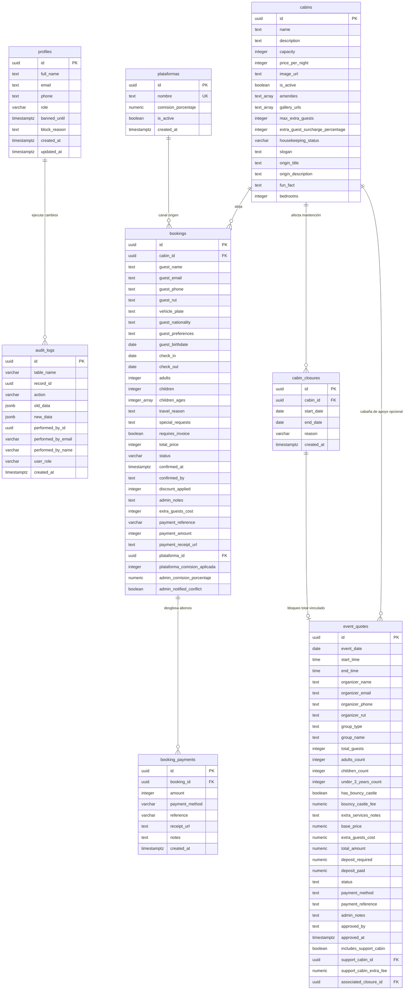

# 🗄️ Documentación Técnica: Modelo de Datos y Base de Datos

**Motor:** PostgreSQL 15+ administrado por Supabase  
**Extensiones Habilitadas:** `pgcrypto` (`gen_random_uuid`)  
**Mecanismo de Seguridad:** Row Level Security (RLS) habilitado globalmente  
**Trazabilidad:** Triggers PL/pgSQL automatizados sobre todas las tablas operativas  

---

## 1. Diagrama Entidad-Relación (ER)

---

## 2. Catálogo Detallado de Tablas

### 2.1. `public.profiles`
Registra a los colaboradores del Rancho y miembros del equipo administrativo enlazados a `auth.users(id)`.
* `id` (`UUID`, PK): Identificador único correspondiente al UUID de `auth.users`.
* `full_name` (`TEXT`): Nombre completo del integrante.
* `email` (`TEXT`): Correo corporativo del integrante.
* `phone` (`TEXT`): Teléfono directo de contacto.
* `role` (`VARCHAR(50)`, default `'staff'`): Rol operativo (`admin`, `staff`, `recepcion`, `mantenimiento`).
* `banned_until` (`TIMESTAMPTZ`): Fecha de suspensión de acceso. Si no es nulo, el usuario está suspendido.
* `block_reason` (`TEXT`): Motivo justificado del bloqueo de cuenta.
* `created_at` / `updated_at` (`TIMESTAMPTZ`): Marcas de tiempo de creación y modificación.

### 2.2. `public.cabins`
Catálogo de alojamientos disponibles en el complejo.
* `id` (`UUID`, PK, default `gen_random_uuid()`): Identificador de la cabaña.
* `name` (`TEXT`, NOT NULL): Nombre comercial (ej: *Cabaña Las Hortensias*, *Suite del Lago*).
* `description` (`TEXT`): Descripción general de comodidades y distribución.
* `capacity` (`INTEGER`, NOT NULL): Capacidad estándar de huéspedes incluidos en la tarifa base.
* `price_per_night` (`INTEGER`, NOT NULL): Precio por noche en pesos chilenos (CLP).
* `image_url` (`TEXT`): URL de la fotografía de portada principal (aspecto recomendado 3:2 / 1200x800).
* `gallery_urls` (`TEXT[]`): URLs de la galería complementaria (banner hero y carrusel).
* `amenities` (`TEXT[]`): Lista de servicios (Wi-Fi, Parrilla, Estacionamiento, Jacuzzi, etc.).
* `max_extra_guests` (`INTEGER`, default `0`): Cantidad máxima de pasajeros adicionales permitidos sobre la capacidad base.
* `extra_guest_surcharge_percentage` (`INTEGER`, default `100`): Porcentaje de cobro sobre el precio base persona para huéspedes extra (mínimo piso garantizado de $10.000 CLP).
* `housekeeping_status` (`VARCHAR(50)`, default `'Disponible'`): Estado de aseo (`'Disponible'`, `'Necesita Aseo'`).
* `slogan` (`TEXT`): Lema o frase de cabecera.
* `origin_title` / `origin_description` (`TEXT`): Título y relato cultural del origen del nombre (Narrativas de Pullally).
* `fun_fact` (`TEXT`): Dato curioso o histórico de la cabaña.
* `bedrooms` (`INTEGER`, default `0`): Número de habitaciones físicas declaradas.
* `is_active` (`BOOLEAN`, default `true`): Bandera para deshabilitar o habilitar la cabaña en el catálogo público.

### 2.3. `public.plataformas`
Canales de venta externos y comisiones comerciales.
* `id` (`UUID`, PK): Identificador del canal.
* `nombre` (`TEXT`, NOT NULL, UNIQUE): Nombre del canal (Directo, Booking.com, Airbnb, etc.).
* `comision_porcentaje` (`NUMERIC`, default `0`): Porcentaje de comisión cobrado por el canal intermediario.
* `is_active` (`BOOLEAN`, default `true`): Estado del canal en selectores.

### 2.4. `public.bookings`
Registro principal de reservas de cabañas.
* `id` (`UUID`, PK): Identificador único de la reserva.
* `cabin_id` (`UUID`, FK a `cabins.id`): Cabaña asignada.
* `guest_name` (`TEXT`, NOT NULL): Nombre completo del titular.
* `guest_email` (`TEXT`): Correo para notificaciones transaccionales.
* `guest_phone` (`TEXT`): Teléfono / WhatsApp del huésped.
* `guest_rut` (`TEXT`): RUT chileno o Pasaporte del titular.
* `vehicle_plate` (`TEXT`): Patente del vehículo del pasajero para control en portón.
* `guest_nationality` (`TEXT`): Nacionalidad o ciudad de procedencia.
* `guest_preferences` (`TEXT`): Requerimientos especiales (cama adicional, llegada tarde, etc.).
* `guest_birthdate` (`DATE`): Fecha de cumpleaños del huésped.
* `check_in` / `check_out` (`DATE`, NOT NULL): Fechas de entrada y salida de la estancia.
* `adults` / `children` (`INTEGER`): Desglose de pasajeros adultos y niños.
* `children_ages` (`INTEGER[]`): Array de edades individuales de cada niño (ej: `{4, 9}`).
* `travel_reason` (`TEXT`): Motivo del viaje y glosa con datos de facturación si aplica.
* `requires_invoice` (`BOOLEAN`, default `false`): Si el cliente requiere Factura con IVA 19% ante el SII.
* `total_price` (`INTEGER`, NOT NULL): Monto total acordado a pagar por la reserva.
* `status` (`VARCHAR(50)`, default `'Pendiente'`): Ciclo de vida (`'Pendiente'`, `'Confirmada'`, `'Cancelada'`, `'checkin'`, `'checkout'`).
* `confirmed_at` (`TIMESTAMPTZ`): Momento exacto de confirmación.
* `confirmed_by` (`TEXT`): Usuario o proceso que confirmó (`'Pago Online (Auto-Webhook)'`, email del recepcionista, etc.).
* `discount_applied` (`INTEGER`, default `0`): Descuento comercial aplicado manualmente.
* `admin_notes` (`TEXT`): Anotaciones privadas de la administración (glosas de adicionales, excepciones, etc.).
* `extra_guests_cost` (`INTEGER`, default `0`): Subtotal atribuible al cobro de pasajeros adicionales.
* `payment_reference` (`VARCHAR(255)`): Identificador de la transacción externa (ej: `MP-123456789`).
* `payment_amount` (`INTEGER`, default `0`): Monto total abonado acumulado.
* `payment_receipt_url` (`TEXT`): URL de comprobante de transferencia física en Supabase Storage.
* `plataforma_id` (`UUID`, FK a `plataformas.id`): Canal por el que ingresó la reserva.
* `plataforma_comision_aplicada` (`INTEGER`, default `0`): Monto en pesos retenido por el canal externo.
* `admin_comision_porcentaje` (`NUMERIC`, default `0`): Porcentaje de administración interna aplicado para la Ficha de Liquidación.
* `admin_notified_conflict` (`BOOLEAN`, default `false`): Marca manual de aviso preventivo en caso de overbooking.

### 2.5. `public.booking_payments`
Bitácora relacional de abonos y transacciones por reserva.
* `id` (`UUID`, PK): Identificador del abono.
* `booking_id` (`UUID`, FK a `bookings.id` con `ON DELETE CASCADE`): Reserva asociada.
* `amount` (`INTEGER`, NOT NULL): Monto del abono en pesos chilenos.
* `payment_method` (`VARCHAR(50)`, NOT NULL): Método utilizado (`'Transferencia'`, `'Efectivo'`, `'Tarjeta'`, `'Pago Online (Mercado Pago)'`, etc.).
* `reference` (`VARCHAR(255)`): Número de operación o folio de pago.
* `receipt_url` (`TEXT`): Enlace al comprobante digitalizado en Storage.
* `notes` (`TEXT`): Glosa explicativa de la transacción.
* `created_at` (`TIMESTAMPTZ`, default `now()`): Fecha y hora del registro.

### 2.6. `public.cabin_closures`
Cierres temporales y bloqueos programados de fechas.
* `id` (`UUID`, PK): Identificador del bloqueo.
* `cabin_id` (`UUID`, FK opcional a `cabins.id`): Si es `NULL`, representa un **Cierre Total Global** de todo el complejo.
* `start_date` / `end_date` (`DATE`, NOT NULL): Rango de fechas bloqueadas (`start_date <= end_date`).
* `reason` (`VARCHAR(255)`, NOT NULL): Justificación (Mantención de piscina, fumigación, vacaciones, evento exclusivo).

### 2.7. `public.event_quotes`
Cotizaciones y arriendos de **Recinto Completo por 8 Horas** (Eventos Diurnos: colegios, adultos mayores, empresas).
* `id` (`UUID`, PK): Identificador único de la cotización de evento.
* `event_date` (`DATE`, NOT NULL): Fecha de realización del evento.
* `start_time` / `end_time` (`TIME`, default `'10:00:00'` / `'18:00:00'`): Horario de inicio y término del arriendo diurno de 8 horas.
* `organizer_name` / `organizer_email` / `organizer_phone` / `organizer_rut` (`TEXT`): Datos del organizador responsable.
* `group_type` (`TEXT`, NOT NULL): Clasificación (`'paseo_curso'`, `'adulto_mayor'`, `'familiar'`, `'empresa'`, `'otro'`).
* `group_name` (`TEXT`): Nombre de la institución o curso (ej: *Colegio San José - 4to Medio B*).
* `total_guests` / `adults_count` / `children_count` (`INTEGER`): Número de asistentes desglosados.
* `under_3_years_count` (`INTEGER`, default `0`): Niños menores de 3 años (liberados de cobro según política comercial).
* `has_bouncy_castle` (`BOOLEAN`, default `false`): Si el grupo trae juego inflable propio.
* `bouncy_castle_fee` (`NUMERIC`, default `0`): Tarifa fija por inflable ($5.000 CLP por consumo eléctrico).
* `base_price` (`NUMERIC`, default `180000`): Tarifa base oficial ($180.000 hasta 15 personas / $250.000 hasta 30 personas).
* `extra_guests_cost` (`NUMERIC`, default `0`): Costo por pasajeros extra sobre el tramo base ($3.500 CLP por persona).
* `total_amount` (`NUMERIC`): Total a pagar por el evento.
* `deposit_required` (`NUMERIC`): Abono mínimo obligatorio exigido (50% del total).
* `deposit_paid` (`NUMERIC`, default `0`): Abono acumulado cancelado.
* `status` (`TEXT`, default `'Cotizacion_Pendiente'`): Ciclo (`'Cotizacion_Pendiente'`, `'Aprobada'`, `'Confirmada'`, `'Rechazada'`, `'Cancelada'`).
* `includes_support_cabin` (`BOOLEAN`, default `false`): Indica si el grupo solicitó cabaña de apoyo opcional.
* `support_cabin_id` (`UUID`, FK a `cabins.id`): Cabaña asignada de apoyo.
* `support_cabin_extra_fee` (`NUMERIC`, default `0`): Recargo pactado por cabaña de apoyo.
* `associated_closure_id` (`UUID`, FK a `cabin_closures.id`): Cierre total en `cabin_closures` generado automáticamente al confirmarse.

### 2.8. `public.settings`
Parámetros institucionales, comisiones globales y llaves del sistema.
* `key` (`VARCHAR(100)`, PK): Identificador de la variable (`whatsapp_number`, `company_name`, `company_rut`, `company_address`, `company_phone`, `company_email`, `default_admin_commission`, `email_sender`, `bank_*`, `vault_*`).
* `value` (`TEXT`, NOT NULL): Valor configurado.
* `description` (`TEXT`): Descripción de uso de la llave.

### 2.9. `public.landing_settings` y `public.landing_gallery`
Contenidos de la página de inicio autogestionable desde el PMS.
* `landing_settings`: Registro único (`id = 1`) que almacena `hero_title`, `hero_subtitle`, `hero_bg_url`, `logo_url`.
* `landing_gallery`: Galería pública con `image_url`, `alt_text`, `order_index`.

### 2.10. `public.audit_logs`
Bitácora de auditoría inmutable e histórica generada por disparador PL/pgSQL.
* `id` (`UUID`, PK): Identificador del registro de auditoría.
* `table_name` (`VARCHAR(100)`): Nombre de la tabla afectada.
* `record_id` (`UUID`): Identificador del registro alterado.
* `action` (`VARCHAR(20)`): Tipo de operación DML (`'INSERT'`, `'UPDATE'`, `'DELETE'`).
* `old_data` (`JSONB`): Snapshot de los datos previos a la mutación.
* `new_data` (`JSONB`): Snapshot de los datos posteriores a la mutación.
* `performed_by_id` (`UUID`): UUID del usuario autenticado que ejecutó la acción.
* `performed_by_email` / `performed_by_name` (`VARCHAR(255)`): Email y nombre del operador.
* `user_role` (`VARCHAR(50)`): Rol del operador en el momento de la acción.
* `created_at` (`TIMESTAMPTZ`, default `now()`): Momento exacto de la modificación.

### 2.11. `public.desarrollo_ideas`
Módulo interno de roadmap y seguimiento de bugs técnicos.
* `id` (`UUID`, PK): Identificador de la tarea.
* `title` (`TEXT`): Título de la propuesta o bug.
* `description` (`TEXT`): Detalle explicativo del requerimiento.
* `category` (`TEXT`): Categoría (`'mejora'`, `'bug'`, `'idea'`, etc.).
* `priority` (`INTEGER`): Orden de prioridad (manejado vía Drag & Drop).
* `completed` (`BOOLEAN`, default `false`): Si la mejora fue terminada.
* `completed_at` (`TIMESTAMPTZ`): Fecha de completado.
* `image_urls` (`TEXT[]`): Capturas de evidencia pegadas con `Ctrl+V` y almacenadas en Supabase Storage.
* `developer_notes` (`TEXT`): Notas técnicas del implementador.

---

## 3. Catálogo de Funciones RPC en Servidor (PostgreSQL)

Para garantizar la seguridad y encapsulación, el sistema implementa funciones con `SECURITY DEFINER` que ejecutan transacciones atómicas sin exponer tablas completas:

| Función RPC | Parámetros | Retorno | Propósito y Permisos |
| :--- | :--- | :--- | :--- |
| `get_occupied_dates(p_cabin_id)` | `p_cabin_id UUID` | `TABLE(check_in DATE, check_out DATE)` | Consulta fechas ocupadas de una cabaña para el calendario público del cliente sin exponer identidades ni datos personales. Concedido a `anon, authenticated`. |
| `check_dates_overlap(...)` | `p_cabin_id UUID, p_check_in DATE, p_check_out DATE` | `BOOLEAN` | Comprobación atómica de colisiones para prevenir overbooking antes del checkout. Concedido a `anon, authenticated`. |
| `create_public_booking(...)` | `p_cabin_id, p_guest_name, p_guest_email, p_guest_phone, p_guest_rut, ...` | `UUID` (ID de reserva) | Inserción defensiva de reserva con casteo nativo de `children_ages` a `INTEGER[]` y bloqueo atómico si hay colisión. Concedido a `anon, authenticated`. |
| `check_full_venue_availability(p_date)` | `p_date DATE` | `JSON` (`{ available, reason }`) | Valida de forma integral si una fecha está libre de reservas de cabañas, cierres de mantención y eventos confirmados para arrendar el recinto completo. Concedido a `anon, authenticated`. |
| `get_occupied_venue_dates()` | *(Ninguno)* | `TABLE(occupied_date DATE)` | Unifica las fechas no disponibles para recinto completo (reservas individuales, cierres totales/parciales y eventos aprobados). Concedido a `anon, authenticated`. |
| `create_public_event_quote(...)` | `p_event_date, p_organizer_name, p_organizer_email, ...` | `UUID` (ID de cotización) | Registra la cotización pública de arriendo de recinto validando disponibilidad previa. Concedido a `anon, authenticated`. |
| `sync_event_quote_closure()` | *(Trigger)* | `TRIGGER` | Trigger que genera automáticamente un cierre total en `cabin_closures` cuando el evento pasa a `'Confirmada'`, o lo elimina si se cancela. |
| `process_audit_logging()` | *(Trigger)* | `TRIGGER` | Trigger universal que intercepta `INSERT`, `UPDATE` y `DELETE` en todas las tablas operativas e inserta el registro histórico enriquecido en `audit_logs`. |
