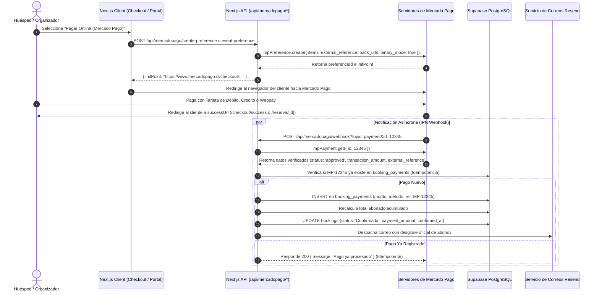

# 💳 Documentación Técnica: Pasarela de Pagos Mercado Pago

**Modo de Integración:** Checkout Pro (Redirección oficial segura con SDK `mercadopago` v3)  
**Moneda:** Pesos Chilenos (`CLP`)  
**Modo Binario:** `binary_mode: true` (Solo estados finales `'approved'` o `'rejected'`, sin revisiones manuales intermedias)  
**Manejo de Idempotencia:** Detección de folios únicos `MP-${paymentId}` en base de datos  

---

## 1. Arquitectura del Flujo de Pagos

El sistema contempla dos modalidades de cobro online a través de Mercado Pago:
1. **Reservas de Cabañas:** Pago de abono inicial (50%) o liquidación de saldo restante antes de la llegada.
2. **Arriendo de Recinto Completo (8 Horas):** Pago de abono obligatorio del 50% para congelar la fecha del evento diurno tras la aprobación de la administración.



---

## 2. Convención de Referencias Externas (`external_reference`)

Para asociar de forma inequívoca el cobro procesado por Mercado Pago con la entidad correspondiente en Supabase sin depender de estados de sesión del navegador, el sistema codifica metadatos en la propiedad `external_reference`:

### A) Reservas de Cabañas:
`{bookingId}__{type}__{amount}`
* `bookingId`: UUID de la reserva en la tabla `bookings`.
* `type`: `'abono'` (primer 50% de reserva) o `'saldo'` (liquidación del 50% restante).
* `amount`: Monto entero en pesos chilenos a cobrar (redondeado con `Math.round`).
* **Ejemplo:** `a3f8b0e1-7c9d-4e5a-8b1c-9f0e1d2c3b4a__abono__85000`

### B) Eventos de Recinto Completo (8 Horas):
`EVENT__{quoteId}__{amount}`
* Prefijo `EVENT__`: Señal distintiva que indica que la transacción pertenece a la tabla `event_quotes`.
* `quoteId`: UUID de la cotización en `event_quotes`.
* `amount`: Monto del abono del 50% pactado.
* **Ejemplo:** `EVENT__5d9f3b1a-8c7e-4b2a-9e1d-3c5a7f9b1e2d__125000`

---

## 3. Principio de Idempotencia y Blindaje de Cancelaciones

En pasarelas de pago modernas, los webhooks pueden reintentar envíos múltiples veces si experimentan latencias de red. Para evitar duplicación de abonos o inconsistencias:

1. **Idempotencia por Folio Único:**
   Antes de insertar cualquier transacción, el webhook ejecuta:
   ```typescript
   const { data: existingPayment } = await supabaseAdmin
     .from('booking_payments')
     .select('id')
     .eq('reference', `MP-${paymentId}`)
     .maybeSingle();

   if (existingPayment) {
     return NextResponse.json({ message: 'Pago ya procesado anteriormente' }, { status: 200 });
   }
   ```
2. **Respeto Estricto a Cancelaciones Administrativas:**
   Si una reserva fue cancelada manualmente en el PMS por el administrador (por ejemplo, debido a mutuo acuerdo, fraude o fuerza mayor), la llegada posterior de un pago de Mercado Pago **NO** revertirá la reserva al estado `'Confirmada'`:
   ```typescript
   if (currentBooking?.status?.toLowerCase() !== 'cancelada') {
     updateBookingData.status = 'Confirmada';
     updateBookingData.confirmed_at = date_approved || new Date().toISOString();
     updateBookingData.confirmed_by = 'Pago Online (Auto-Webhook)';
   }
   ```
   El pago se registra en `booking_payments` para fines de auditoría y contabilidad, pero el estado `'Cancelada'` se preserva intacto.

---

## 4. Sincronización Manual Bajo Demanda (`/api/mercadopago/sync`)

En escenarios de contingencia donde un webhook de Mercado Pago no pueda alcanzar el servidor (por ejemplo, en entornos locales de desarrollo sin túnel ngrok público, o por caídas temporales de red):
* El sistema dispone del endpoint [`/api/mercadopago/sync`](file:///c:/Users/Petazo/Desktop/Pagina%20rancho%20Carmelitas/rancho-carmelitas-web/src/app/api/mercadopago/sync/route.ts).
* Puede ser invocado automáticamente por el portal del cliente cuando una reserva figura como `'Pendiente'`, o manualmente desde el PMS.
* Consulta a la API de Mercado Pago (`mpPayment.search({ sort: 'date_created', criteria: 'desc', limit: 30 })`), identifica pagos aprobados para la reserva y los acredita de inmediato sin generar duplicados.
