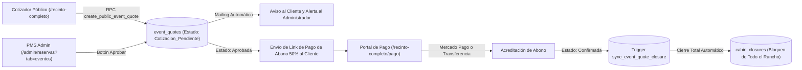

# 🎪 Documentación Técnica: Sistema de Arriendo de Recinto Completo (Eventos Diurnos de 8 Horas)

**Propósito:** Comercialización y gestión operativa del uso exclusivo del complejo para grupos masivos (paseos de curso, adultos mayores, familias e instituciones)  
**Horario Estándar:** Bloque diurno de 8 horas continuas (10:00 a 18:00 hrs)  
**Infraestructura Incluida:** Quincho techado equipado (parrilla, refrigerador, microondas, mesas), piscina familiar, baños exteriores, áreas verdes y estacionamiento privado  

---

## 1. Reglas de Negocio y Motor Tarifario Oficial

El sistema implementa el modelo comercial oficial validado por la administración de Rancho Carmelitas:

### A) Tramos Base Oficiales
* **Tramo Base 1 (Grupos Pequeños):**
  - Hasta **15 personas** = **$180.000 CLP**.
  - Si el grupo supera las 15 personas pero no excede las 20, se aplica la base de $180.000 más el cobro de pasajeros adicionales.
* **Tramo Base 2 (Grupos Medianos y Grandes):**
  - De **16 a 30 personas** = **$250.000 CLP**.
  - Si el grupo supera las 30 personas, se aplica la base de $250.000 más el cobro de pasajeros adicionales.

### B) Pasajeros Adicionales y Exenciones
* **Valor por Persona Adicional:** **$3.500 CLP** por cada asistente sobre el cupo base del tramo.
* **Exención por Edad (Menores de 3 Años):** Los niños menores de 3 años están **liberados de cobro**. El cotizador solicita desglosar la cantidad de menores de 3 años y los descuenta del cálculo financiero, manteniéndolos en la nómina total para control de aforo.

### C) Servicios Extra y Políticas
* **Juegos Inflables propios:** Si el grupo ingresa un inflable propio, se aplica un recargo fijo de **$5.000 CLP** por concepto de consumo eléctrico del motor soplador.
* **Abono Mínimo Requerido:** **50% del total presupuestado** para congelar y reservar la fecha de forma definitiva.
* **Cabaña de Apoyo Opcional (Excepción Conversada):** Los eventos diurnos no incluyen cabañas por defecto. Si el organizador necesita una cabaña para mudar bebés, refrigerar medicamentos o descanso de adultos mayores, la administración puede asignar una cabaña de apoyo en el PMS ingresando un suplemento acordado.

---

## 2. Componentes de la Arquitectura de Software



---

## 3. Especificación de Funciones y Triggers en PostgreSQL

### 3.1. `check_full_venue_availability(p_date DATE) -> JSON`
Valida de forma atómica si una fecha específica está disponible para Arriendo de Recinto Completo:
1. Verifica si existen reservas individuales de cabañas en `bookings` que solapen con esa fecha (`status != 'Cancelada'`).
2. Verifica si existen cierres temporales en `cabin_closures` (totales o parciales).
3. Verifica si ya existe otro evento confirmado o aprobado en `event_quotes` para ese día.
* Retorna `{ "available": boolean, "reason": string }`.

### 3.2. `get_occupied_venue_dates() -> TABLE (occupied_date DATE)`
Genera la unión de todas las fechas que no pueden ser seleccionadas en el calendario del cotizador:
```sql
SELECT DISTINCT d::DATE FROM bookings b, generate_series(b.check_in, b.check_out, '1 day'::interval) d WHERE b.status != 'Cancelada'
UNION
SELECT DISTINCT d::DATE FROM cabin_closures c, generate_series(c.start_date, c.end_date, '1 day'::interval) d
UNION
SELECT event_date FROM event_quotes WHERE status IN ('Confirmada', 'Aprobada');
```

### 3.3. Trigger de Sincronización Automática con `cabin_closures`
La función `sync_event_quote_closure()` se dispara ante cambios de estado en `event_quotes`:
* **Al confirmarse (`NEW.status = 'Confirmada'`):** Inserta un registro en `cabin_closures` con `cabin_id = NULL` (Cierre Total Global) para la fecha del evento con la glosa `"Evento Exclusivo Recinto: [Grupo]"` y guarda el `associated_closure_id`.
* **Al cancelarse o rechazarse:** Elimina automáticamente el cierre de `cabin_closures` liberando las cabañas para arriendos normales.

---

## 4. Visualización en el Dashboard del PMS

En [`src/app/admin/page.tsx`](file:///c:/Users/Petazo/Desktop/Pagina%20rancho%20Carmelitas/rancho-carmelitas-web/src/app/admin/page.tsx), los eventos de recinto completo se integran con el calendario general y la lista de llegadas:
* **Código Cromático Homologado:**
  - 🟡 **Amarillo (`Cotizacion_Pendiente`):** Solicitud recibida pendiente de revisión.
  - 🔵 **Azul (`Aprobada`):** Cotización aprobada esperando el pago del 50%.
  - 🟢 **Verde (`Confirmada`):** Abono acreditado y recinto bloqueado al 100%.
* **Navegación Asistida:** Al hacer clic en un evento desde el Dashboard, el sistema redirige automáticamente a `/admin/reservas?tab=eventos&id=${quote.id}`, abriendo la pestaña de eventos y aplicando un resalte visual animado sobre la cotización elegida.
