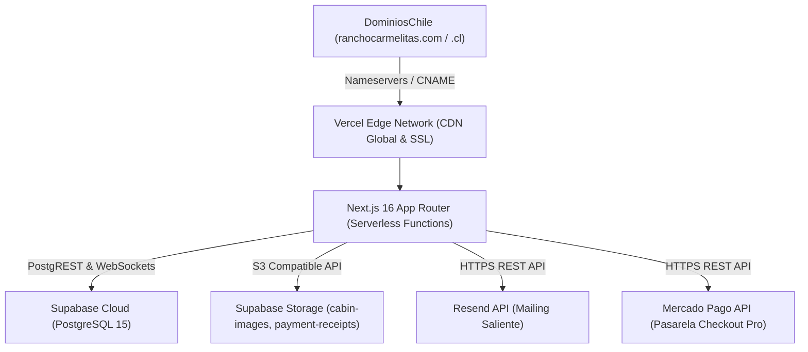

# 🚀 Documentación Técnica: Infraestructura, Hosting y Despliegue

**Plataforma de Hosting:** Vercel (Edge & Serverless Network)  
**Base de Datos y Autenticación:** Supabase Cloud (PostgreSQL 15+)  
**Dominios y DNS:** DominiosChile / Vercel DNS con SSL automático  
**Mailing:** Resend Cloud  

---

## 1. Topología de Infraestructura

---

## 2. Variables de Entorno del Sistema

Para el correcto funcionamiento tanto en desarrollo local como en producción en Vercel, deben configurarse las siguientes variables:

| Variable | Tipo | Ámbito | Descripción |
| :--- | :--- | :--- | :--- |
| `NEXT_PUBLIC_SUPABASE_URL` | Pública (`NEXT_PUBLIC_`) | Frontend & Backend | URL del proyecto Supabase (ej: `https://xyz.supabase.co`). |
| `NEXT_PUBLIC_SUPABASE_ANON_KEY` | Pública (`NEXT_PUBLIC_`) | Frontend & Backend | Clave pública anónima de Supabase con permisos limitados por RLS. |
| `SUPABASE_SERVICE_ROLE_KEY` | **Secreta (Crítica)** | Solo Backend | Clave maestra administrativa de Supabase que bypasséa RLS para tareas del sistema. |
| `RESEND_API_KEY` | **Secreta (Crítica)** | Solo Backend | Clave de API saliente para el despacho de correos transaccionales. |
| `MERCADOPAGO_ACCESS_TOKEN` | **Secreta (Crítica)** | Solo Backend | Token de acceso de producción o prueba provisto por Mercado Pago. |
| `MERCADOPAGO_SANDBOX` | Booleana (`'true'` / `'false'`) | Backend | Indica si se debe operar en entorno de pruebas sandbox o pasarela real. |
| `NEXT_PUBLIC_VERCEL_ANALYTICS_ID`| Pública | Frontend | Identificador de métricas de rendimiento en Vercel. |

---

## 3. Protocolos de Respaldo y Clonación (Producción -> Test)

El sistema cuenta con utilidades en el directorio `migration/`:
1. **Clonador Integral de Base de Datos ([`migration/clonar_datos_completos.js`](file:///c:/Users/Petazo/Desktop/Pagina%20rancho%20Carmelitas/rancho-carmelitas-web/migration/clonar_datos_completos.js)):**
   - Extrae de manera secuencial todos los registros de Producción (cabañas, reservas, pagos, cierres, configuraciones, ideas del roadmap, bitácoras y galerías).
   - Realiza un vaciado seguro en el entorno de Test e inserta los datos respetando las restricciones de integridad relacional (llaves foráneas).
   - Comando de ejecución: `node migration/clonar_datos_completos.js`.
2. **Importador Masivo de Excel ([`migration/importador.js`](file:///c:/Users/Petazo/Desktop/Pagina%20rancho%20Carmelitas/rancho-carmelitas-web/migration/importador.js)):**
   - Transforma archivos CSV delimitados por punto y coma (generados desde planillas de control histórico de arriendos) en registros normalizados en las tablas `cabins`, `plataformas`, `bookings` y `booking_payments`.
   - Comando de ejecución: `node migration/importador.js migration/plantilla_carga_masiva.csv`.

---

## 4. Gobernanza in-app y Llavero Seguro (Vault)

En la ruta administrativa [`/admin/infraestructura`](file:///c:/Users/Petazo/Desktop/Pagina%20rancho%20Carmelitas/rancho-carmelitas-web/src/app/admin/infraestructura/page.tsx), los administradores disponen de un panel de gobernanza para consultar y actualizar parámetros clave del negocio sin necesidad de editar código fuente ni redesplegar en Vercel.

Para consultar o copiar credenciales críticas (contraseña de DominiosChile, Vercel o la clave de Resend), la interfaz exige una **re-autenticación obligatoria con la contraseña del usuario logueado**, previniendo que un colaborador no autorizado copie claves nucleares de la pantalla.
