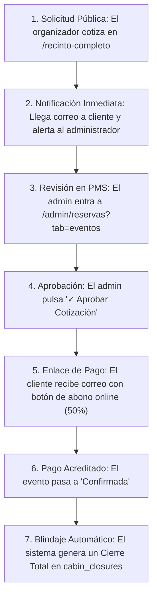

# 🎪 Manual de Usuario: 06. Arriendo de Recinto Completo (Eventos Diurnos de 8 Horas)

**Pantalla:** `/admin/reservas?tab=eventos` (o acceso directo desde los eventos del Dashboard)  
**Roles involucrados:** Administradores y Recepcionistas  

---

## 1. Concepto y Alcance del Arriendo de Recinto

El servicio de Arriendo de Recinto Completo está diseñado exclusivamente para **eventos diurnos de 8 horas continuas (horario estándar de 10:00 a 18:00 hrs)**, orientados a:
* Paseos de fin de año de colegios y cursos escolares.
* Agrupaciones de adultos mayores y clubes sociales.
* Encuentros familiares masivos (cumpleaños, aniversarios).
* Jornadas de esparcimiento para empresas e instituciones.

### ¿Qué instalaciones incluye el uso exclusivo del recinto?
* **Quincho Techado Equipado:** Parrilla para asados, refrigerador, microondas, hervidor, mesas largas y bancas de madera.
* **Piscina Familiar:** Acceso exclusivo para el grupo respetando las normas de higiene y seguridad.
* **Baños y Camarines Exteriores.**
* **Áreas Verdes, Canchas y Jardines.**
* **Estacionamiento Privado** dentro del complejo.

> [!IMPORTANT]
> **No Incluye Cabañas por Defecto:** Este servicio es diurno y no contempla el uso interior de cabañas para hospedaje, salvo que se pacte explícitamente una **Cabaña de Apoyo** con la administración.

---

## 2. Tarifario Oficial y Parámetros Comerciales (v2.4.x)

El cotizador público y el sistema administrativo aplican las siguientes reglas oficiales autogestionables desde `/admin/configuraciones`:

| Concepto | Regla y Valor Oficial | Notas de Operación |
| :--- | :--- | :--- |
| **Tarifas Fijas por Tramo** | Configurables en `/admin/configuraciones` | Rangos sin gaps (ej: 1 a 20 pers: $190.000, 21 a 40 pers: $250.000, 41 a 70 pers: $350.000). |
| **Asistentes Adicionales** | **Coordinar con administración** | Se suprime el cobro unitario por adicional en recinto. El cliente especifica extras en observaciones. |
| **Menores de 3 Años** | **$0 CLP (Liberados de cobro)** | No pagan entrada. Se registran en el aforo total por seguridad y control de acceso. |
| **Juego Inflable Propio** | **Configurable (Defecto $5.000 CLP)** | Recargo fijo para cubrir el consumo del motor eléctrico del inflable. |
| **Abono Obligatorio** | **Configurable (Defecto 50%)** | Monto requerido para congelar y confirmar la fecha en el calendario. |
| **Aforo Máximo Físico** | **Configurable (Defecto 70 personas)** | Al sobrepasarse, el cotizador desvía la consulta a WhatsApp para cotización corporativa. |

---

## 3. Flujo Paso a Paso de una Solicitud de Evento

---

## 4. Gestión del Evento en el Panel Administrativo

En la pestaña **"🎪 Arriendos de Recinto (8h)"** encontrarás la tabla de cotizaciones con las siguientes herramientas:

### A) Filtro de Estados
Puedes filtrar por: *Todos*, *Pendientes de Aprobación*, *Aprobadas (esperando pago)* o *Confirmadas*.

### B) Botón "✓ Aprobar Cotización"
* Cuando revisas los datos de un colegio o institución y confirmas que la fecha es viable, presiona **"✓ Aprobar"**.
* El sistema actualizará el estado a `'Aprobada'` y despachará automáticamente un correo formal al organizador con el botón de pago oficial del 50% de abono.

### C) Botón "💳 Registrar Abono Manual"
* Si el organizador realiza una transferencia bancaria directa a la cuenta del Rancho o paga en efectivo:
  1. Haz clic en **"💳 Registrar Abono"**.
  2. Ingresa el monto transferido, el medio de pago y el número de operación.
  3. Presiona **"Guardar Abono"**.
  4. El sistema promoverá el evento al estado **`'Confirmada'`** y activará el cierre total de cabañas para ese día.

### D) Asignación de Cabaña de Apoyo (Excepción Conversada)
* Si el grupo necesita un espacio techado adicional para mudar lactantes o descanso de personas mayores:
  1. Haz clic en el botón morado **"🏡 Cabaña de Apoyo"**.
  2. Selecciona la cabaña disponible que se asignará al grupo.
  3. Ingresa el suplemento pactado (o `$0` si se otorga como cortesía comercial).
  4. Presiona **"Vincular Cabaña"**.

---

## 5. Portal de Seguimiento del Organizador (`/recinto-completo/pago`)

El organizador del evento cuenta con una página exclusiva para su grupo:
* Puede ingresar su folio de cotización en cualquier momento para ver el estado de su solicitud.
* Si la cotización fue aprobada, la pantalla despliega el botón oficial de **Mercado Pago** para abonar con tarjeta de débito, crédito o Webpay con acreditación instantánea.
* Una vez acreditado el abono, la página muta a una ficha de confirmación con el sello oficial del Rancho, las políticas del quincho y las indicaciones de llegada para el chofer del bus escolar o los vehículos del grupo.

---

## 6. Ingreso Manual de Reservas de Recinto desde el PMS

Desde `/admin/reservas` haciendo clic en **"+ Nueva Reserva Manual"** y eligiendo la pestaña **`🎪 Recinto Completo (Evento 8h)`**:

* **Calendario Visual de Disponibilidad:** Antes de elegir el día, el calendario mensual marca automáticamente los días ocupados por cabañas o eventos previos en color rojo tachado (`⛔ Ocupado`).
* **Horarios Estándar y Avisos:** Puedes elegir rápidamente entre `10:00 a 18:00`, `11:00 a 19:00` o `12:00 a 20:00 (Límite)`. Si ingresas otro horario o superas las 20:00 hrs, el sistema mostrará una advertencia visual informativa (no bloqueante).
* **Estados Iniciales Flexibles:**
  * **🟢 Confirmada:** Bloquea todas las cabañas automáticamente para esa fecha. Puedes registrar un abono inicial de `$0` (Sin Abono), `50%`, `100%` o un monto personalizado.
  * **🟡 Aprobada (Enviar link de pago al cliente):** Envía automáticamente al correo del organizador el botón oficial de pago del 50% vía Mercado Pago o transferencia bancaria.
  * **⚪ Cotización Pendiente:** Guarda la solicitud en revisión interna sin bloquear fechas ni notificar al cliente todavía.

---

## 7. Historial de Pagos Separado y Cobro de Saldo

Cada pago realizado para un evento (ya sea en línea por Mercado Pago, al crear la reserva manual o posteriormente en puerta) se guarda como un **registro independiente** en el historial de la tarjeta:

* **Visualización Cronológica:** Bajo los detalles del evento verás el listado **`🧾 Historial de Pagos Registrados`** con el número de cuota (`#1`, `#2`...), monto, medio de pago, referencia, nota y fecha/hora.
* **Cobro de Saldo en Eventos Confirmados:** Mientras el evento tenga saldo pendiente (`Total Arriendo - Total Pagado > $0`), el botón **`💵 Cobrar Saldo ($X)`** permanecerá activo aunque el evento ya esté confirmado. Esto permite cobrar el 50% restante al llegar el grupo (o antes/después) en Efectivo, Transferencia o POS sin sobreescribir el primer abono.
* **Corrección de Pagos:** Si registraste un monto por error, puedes anular la cuota específica haciendo clic en el ícono `🗑️` de esa fila; el saldo se recalculará automáticamente.

---

## 8. Edición Integral, Check-in y Finalización del Evento

En la pestaña de **Eventos (`/admin/reservas?tab=eventos`)**, el administrador dispone del ciclo operativo completo:

1. **Edición Integral (`✏️ Editar`):** Permite modificar la fecha del evento (sincronizando automáticamente el bloqueo en calendario si está confirmado), horario, datos del organizador, cantidad de asistentes (con botón **`⚡ Recalcular Monto con Tramos`**), inflables, estado y notas.
2. **Check-in / Inicio de Uso (`🔑 Check-in`):** Se activa cuando el evento está `Confirmada` y pendiente de ingreso (`⏳ Pendiente de Ingreso`).
   * Verifica que el saldo esté en **`$0 (100% Pagado)`** antes de entregar las instalaciones.
   * Si existe saldo pendiente, ofrece acceso directo para cobrarlo o permite autorizar el ingreso excepcionalmente dejando un motivo registrado.
   * Al confirmarse, el evento pasa a **`🔑 En Uso (Check-in OK)`**.
3. **Finalizar / Entrega Conforme (`🏁 Finalizar`):** Al término de la jornada (máx. 20:00 hrs), el administrador verifica el checklist de estado del quincho, piscina, áreas verdes, baños y cabaña de apoyo (si hubo), pudiendo dejar observaciones de entrega. El evento queda marcado como **`🏁 Finalizado (Entregado)`**.
